# awswiz

> Friendly AWS credentials CLI — interactive wizards for profiles, MFA, assume-role, SSO and more.

**awswiz** takes the friction out of managing AWS credentials from the terminal. Instead of memorizing `aws sts` incantations or hand-editing `~/.aws`, you answer simple questions. It talks to AWS directly through the SDK and edits your `~/.aws` files for you — so it works **without the `aws` CLI installed**. The UI speaks **English and Spanish** (auto-detected).

<p align="center">
  
</p>

## Install

```bash
npm install -g @fsichi/awswiz
# or run it without installing:
npx @fsichi/awswiz whoami
```

After installing, the command is just `awswiz` (e.g. `awswiz whoami`).

Requires Node.js >= 20. That's it — no `aws` CLI, no Python, no setup.

## Commands

Run `awswiz` on its own (in a terminal) to open an interactive menu. Or call any command directly:

| Command | What it does |
|---|---|
| `awswiz status` | Which sessions are alive and when do they expire? Your daily "am I still logged in?". |
| `awswiz whoami` | Which account, role and profile am I using right now — and how long do these credentials last? |
| `awswiz mfa` | Start an MFA session — auto-discovers your device, creates a temporary `<profile>-mfa` profile. |
| `awswiz assume` | Assume an IAM role (cross-account), with MFA, and save the temporary credentials. |
| `awswiz login` | Sign in to IAM Identity Center (SSO) via the browser device flow — then verifies it really worked. |
| `awswiz console` | Open the AWS **web console** in your browser, already signed in with a profile. |
| `awswiz exec` | Run any command with a profile's credentials: `awswiz exec -p prod -- terraform plan`. |
| `awswiz use` | Switch the active profile (prints the right export line, or writes `[default]`). |
| `awswiz region` | Set the default region for a profile. |
| `awswiz profile` | Manage profiles: `list`, `add` (masked secret input), `edit`, `remove`. |
| `awswiz clean` | Remove expired temporary session profiles that piled up in `~/.aws`. |
| `awswiz doctor` | Check your setup: `~/.aws` files, profiles, and clock skew (the silent MFA killer). |
| `awswiz update` | Update awswiz to the latest version. |

### `awswiz status`

The command you run every morning. Shows each temporary session (MFA / assumed roles) with its remaining lifetime, each SSO session — checked with Identity Center, with when you signed in and when it ends — and the active profile — with the exact renewal command next to anything expired:

```
Temporary sessions:
  horsego-mfa   ✔ expires in 11h 40m
  codetria-mfa  ✖ expired   → awswiz mfa -p codetria

SSO sessions:
  boostivity    ✔ signed in · started 2h 5m ago · ends ~21:24 (in 5h 55m)
  legacy-sso    ✖ session ended   → awswiz login -p legacy-sso

Active profile: default (AWS_PROFILE not set)
```

Sessions created by awswiz record their expiration (`aws_session_expiration`) so status can tell you *before* AWS fails with a cryptic `ExpiredToken`. An SSO access token lasts one hour; the SDK renews it with its refresh token for as long as the Identity Center session lasts (an admin setting: 8 h by default, up to 90 days). AWS never says when that session ends, so when the token has expired `status` asks Identity Center by renewing it — exactly what the SDK would do on your next call: a session that still works shows as signed in, one that ended shows the `awswiz login` command, and with no network it says it could not check. `--offline` skips the check.

To see when a session ends, `awswiz login` records when you signed in (`~/.config/awswiz/sso-sign-ins.json`, no secrets) and you add your organization's session length to the `[sso-session]` section (or the profile, for legacy start-URL profiles):

```ini
[sso-session boostivity]
sso_start_url = https://example.awsapps.com/start
sso_region = us-east-1
awswiz_session_duration = 8h
```

`8h`, `12h30m` or `1d` work; the SDK and the `aws` CLI ignore the key. The end is an estimate (`~`) — an admin can change the length or revoke the session. A token without a refresh token (`aws sso login` with a legacy profile) lasts the whole session, so its end is shown exactly.

`awswiz status --json` returns the same as data — each session's `expiresAt` and `state`, each SSO session's `state`, `signedInAt` and `sessionEndsAt` (with `sessionEndSource`: `token` exact, `config` estimated), and the renewal command — **never a key or a token**, so scripts and agents can check a session without reading AWS's caches themselves. `awswiz whoami --json` does the same for the identity.

### `awswiz exec`

Run one command with a profile's credentials — no shell exports, no `[default]` rewriting: `awswiz exec -p horsego-mfa -- aws s3 ls`. Everything after `--` is passed through untouched — including on Windows, where `.cmd` tools (`npx`, `cdk`, `serverless`…) get every argument quoted for `cmd.exe`, so `"my file.txt"` stays one argument and a `&` stays text. awswiz's own line goes to stderr, so `awswiz exec -p prod -- aws s3api list-buckets | jq` pipes only the command's output, and the exit code is the command's.

If the session has already expired, it offers to **renew it right there** — MFA for `<base>-mfa` sessions, a sign-in for SSO profiles. Without a terminal (scripts, agents) it stops *before* running the command, with the renewal command in the error, instead of letting it fail halfway.

### `awswiz clean`

Temporary sessions accumulate: `prod-mfa`, `admin-role`, that account you touched once in March. `clean` lists the dead ones and removes them from `~/.aws` — profiles with long-lived keys, SSO or role configuration are never offered. `--yes` removes only the provably expired ones, so it's safe in scripts.

### `awswiz console`

`awswiz console -p prod` opens the AWS web console in your browser, already signed in with that profile (via the AWS sign-in federation endpoint). Works with long-lived keys (federation token), SSO and role profiles. `--print-url` prints the link instead of opening the browser — note the URL itself is a short-lived credential.

### `awswiz mfa`

The MFA ritual, minus the pain. Pick the profile with your long-lived keys; awswiz **auto-discovers your MFA device** (via `iam:ListMFADevices`), asks for the 6-digit code, and stores a temporary session as `<profile>-mfa` — the long-standing convention. The expiration is shown and recorded, so `awswiz status` can warn you before it bites.

```bash
awswiz mfa                              # interactive
awswiz mfa -p myprofile -c 123456       # non-interactive (scripts/CI)
```

### `awswiz assume`

Assume a role in another account using a source profile's credentials (keys, an MFA session, SSO, or a role profile — whose own role is assumed with its `source_profile`). Prompts for MFA when the source needs it, then writes the temporary credentials to a profile you name. It refuses to write them over a profile that has its own credentials (long-lived keys, SSO, a role), so a role called `dev` can never overwrite your `dev` profile — and it checks that before using your MFA code.

### `awswiz login` (SSO)

Picks the SSO profile straight from your config — resolving the modern `[sso-session]` sections, so you never type the start URL. Then it takes the least intrusive path available:

1. **Still signed in?** Nothing happens — no browser, no prompts.
2. **Expired but refreshable?** The session renews silently in the background.
3. **Needs a real sign-in?** Your browser opens straight at Identity Center (authorization code + PKCE, the same flow the modern `aws` CLI uses) — no code to type, and the client registration is cached and reused, so AWS stops asking you to authorize the app on every login.
4. **Redirect flow unavailable?** Falls back to the device-code flow automatically (`--device-code` forces it).

The token is cached **exactly where the SDK and the `aws` CLI look for it** (session-name key for modern configs, start-URL key for legacy ones), together with the refresh token, so everything else just works afterwards. And it doesn't merely claim success: it verifies the profile resolves credentials via STS and shows you the account you landed in.

```bash
awswiz login                 # pick a profile, sign in if needed
awswiz login -p prod         # straight to a profile
awswiz login -p prod --force # sign in again even if the session is valid
```

### `awswiz use`

A tool can't change your parent shell's environment, so `use` prints the exact line for your shell (`export AWS_PROFILE=…`, PowerShell `$env:…`, fish `set -x …`). Prefer no env var? `awswiz use <profile> --default` makes `[default]` exactly that profile, so plain `aws`/SDK calls use it everywhere — replacing what was there, so no old session token or static key keeps winning over the new identity. If `[default]` held access keys that exist in no other profile, they are saved first as `default-backup`.

### `awswiz doctor`

Verifies your `~/.aws` files exist, counts your profiles, and — crucially — checks your clock against AWS. MFA codes are time-based, so a skewed clock produces baffling "invalid token" errors; doctor catches it.

## How it works

| Concern | Approach |
|---|---|
| **Profiles** | awswiz reads/writes `~/.aws/config` and `~/.aws/credentials` directly, with a comment-preserving INI editor — your formatting and comments survive. |
| **MFA / assume-role** | `@aws-sdk/client-sts` (`GetSessionToken`, `AssumeRole`). |
| **MFA device discovery** | `@aws-sdk/client-iam` (`ListMFADevices`). |
| **SSO** | `@aws-sdk/client-sso-oidc` — authorization code + PKCE in the browser (device code as fallback), token cached with the same keys the CLI uses. |
| **Web console sign-in** | AWS sign-in federation endpoint — `GetFederationToken` for long-lived keys, direct temporary credentials for SSO/role profiles. |
| **Session expiry** | `mfa`/`assume` record `aws_session_expiration` in the credentials file; `status` and `exec` read it. An expired SSO token is checked with a refresh-token `CreateToken` call (Identity Center's only answer to "is this session alive?"). |

No `aws` CLI is spawned or required. `~/.aws` files are written atomically (a crash never leaves a half-written credentials file, and a symlinked file stays a symlink); the credentials file and the SSO token cache are private (`0600`, folder `0700`) on Unix, and secrets are never logged. The AWS SDK is loaded only by the commands that call AWS, so `use`, `region` or `status` (unless it has to check an expired SSO token) start in about a tenth of a second, and the package installs with no dependencies.

## Non-interactive mode & AI agents

The wizards are for humans, but the credential commands also take flags so scripts, CI **and AI coding agents** can run them headless — a bare interactive command in a non-TTY context fails fast instead of hanging:

```bash
awswiz mfa --profile prod --code 123456
awswiz assume --profile prod --role arn:aws:iam::123456789012:role/Admin --code 123456
awswiz exec -p prod -- aws s3 ls
awswiz region prod eu-west-1
awswiz use prod --default
awswiz status --json         # always safe; no secrets (may renew an expired SSO token, like the SDK)
awswiz whoami -p prod --json
```

With `--json`, stdout carries only the payload — a failure too, as `{"error": "…", "hint": "…"}` — and without a terminal the output is plain text, no color codes.

The repo ships an [`AGENTS.md`](AGENTS.md) with the full non-interactive matrix and the security rules agents should follow (never pass secrets as flags, never log sign-in URLs). awswiz deliberately does **not** accept access keys as CLI flags — they would leak into shell history.

## Troubleshooting

### Windows: `NVM blocked package-manager execution because a delegated command could not be trusted` (NVM4306)

NVM for Windows 2.x keeps a trust record of every global command and refuses one whose launcher changed since it was trusted. Updating awswiz rewrites `awswiz.cmd`, so right after `awswiz update` (or `npm i -g @fsichi/awswiz`) the next `awswiz` can be blocked with *"delegated script changed since it was trusted"*. That is NVM protecting you, not a broken install. NVM may re-trust the command by itself shortly after; if it doesn't, run:

```bash
nvm reshim
```

`awswiz update` reminds you of this when it detects an NVM for Windows 2.x install.

## Language

awswiz follows your system locale (English or Spanish). Force it for one run with the `AWSWIZ_LANG` environment variable (`AWSWIZ_LANG=es awswiz whoami`).

## License

MIT © Facundo Sichi
